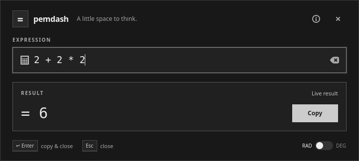

# pemdash

A small calculator overlay with proper operator precedence.



## Install on Arch Linux

```bash
yay -S pemdash
```

Install the clipboard helper for your session (one is enough):

```bash
sudo pacman -S wl-clipboard # Wayland, including niri
sudo pacman -S xclip        # X11
```

These helpers keep copied results available after pemdash exits; a clipboard manager is not required.

## Use

```bash
cargo run --release
```

Type an expression. The result updates as you type.

A compact dark overlay with a focused expression field, live result card, and keyboard-first controls. The footer shows `Enter` to copy a valid result and close, and `Esc` to close.

- `Enter` in the expression field copies a valid result and closes pemdash only after the clipboard helper succeeds. Empty or invalid input leaves the window open and does not copy an earlier result. If copying fails, the window stays open with a `Copy failed` status (hover for details) and a `Retry` button.
- `Escape` closes pemdash, including when another control has focus.
- `Copy` copies a valid result without closing. It is disabled for empty or invalid input, and confirms when a result has been copied.
- The clear icon resets the expression. The help button opens a function reference with clickable examples.
- Click `RAD` / `DEG` in the footer to switch between radians and degrees. The current expression recalculates immediately. Each launch starts in `RAD`.
- Drag the header to move the overlay, or use its close button.
- Long results stay within the window; hover to see the full value, or copy it without truncation.

## Calculation rules

Supported operators are `+`, `-`, `*`, `/`, and `^`. Constants are `pi`, `e`, and `tau`.

- Parentheses override operator precedence.
- Exponentiation binds more tightly than unary signs, followed by multiplication and division, then addition and subtraction. `-2^2` is `-4`, while `(-2)^2` is `4`.
- Exponentiation is right-associative: `2^3^2` means `2^(3^2)` and gives `512`.
- Multiplication must be explicit. Use `2 * pi`, not `2pi`.
- Decimal numbers and scientific notation are supported, including `.5` and `1e-3`. Whitespace is ignored, and a trailing `=` is accepted.
- Calculations use `f64` floating-point numbers. Decimal arithmetic can show rounding artifacts, such as `0.1 + 0.2` producing `0.30000000000000004`.

| Functions | Arguments and behavior |
| --- | --- |
| `sin`, `cos`, `tan` | One angle in the selected RAD / DEG mode |
| `asin`, `acos`, `atan` | One value, returning an angle in the selected mode |
| `atan2(y, x)` | Two values, returning an angle in the selected mode |
| `sqrt`, `abs`, `exp`, `ln`, `log10` | One value; `ln` is the natural logarithm |
| `floor`, `ceil`, `round` | One value; `round` rounds halfway cases away from zero |
| `pow(base, exponent)` | Two values, equivalent to `base ^ exponent` |
| `min`, `max` | One or more comma-separated values |

Invalid syntax, unknown names, and incorrect argument counts display an error. Division by zero, results outside the finite range, and results that are not real numbers also display an error instead of enabling Copy. Numeric literals and intermediate results are checked, so `1e999`, `sqrt(-1)`, and `(1 / 0)^0` are rejected.

Examples:

```text
2 + 2 * 2
-2^2
sin(pi / 2)
50 / sqrt(3) * 1e5
max(2, 8, 3)
```

## Bind to Alt+F2 in niri

Build and install the binary somewhere on `PATH`, then add a binding to the `binds` block in `~/.config/niri/config.kdl`:

```kdl
Alt+F2 { spawn "pemdash"; }
```

A floating-window rule is optional:

```kdl
window-rule {
    match app-id="dev.pixelcluster.pemdash"
    open-floating true
}
```
